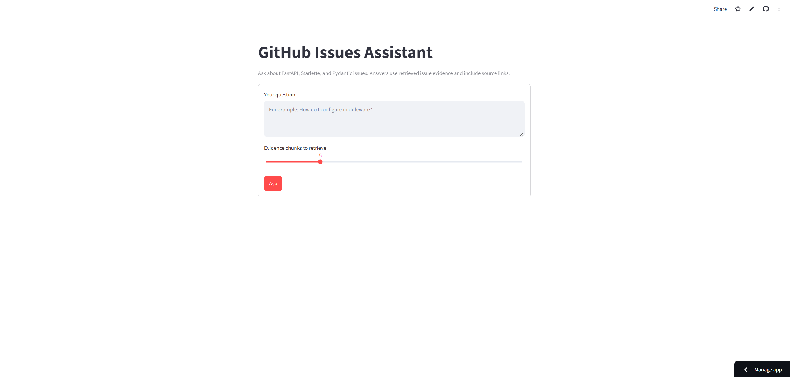
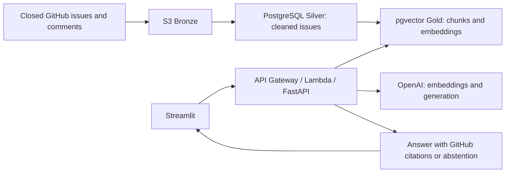

# Trustworthy RAG Assistant for GitHub Issues

An evidence-grounded assistant for closed **FastAPI, Starlette, and Pydantic**
issues. Ask a question, retrieve relevant issue discussions, and get an answer
with GitHub citations. When the evidence is insufficient, the assistant can abstain.

Built with PostgreSQL/pgvector, FastAPI, OpenAI, AWS Lambda/API Gateway, and Streamlit.



**Demo video:** [link pending]

## Architecture



The pipeline stores raw issue discussions, cleans and chunks them, and builds
embeddings for retrieval. The API retrieves 30 candidate chunks and selects up
to five distinct issues before applying confidence and generation safeguards.
The Streamlit client calls the authenticated API from server-side Python.

## Results at a glance

Recorded corpus: **9,555 issues, 43,535 comments, and 63,002 chunks** across the
three configured repositories. Pull requests are excluded.

| Evidence | Scope and result |
|---|---|
| Historical retrieval development set | **45 generated answerable cases**, before author review. Hit@5 **0.8000 to 0.9333**; Recall@5 **0.9333** and MRR **0.7526 to 0.8389** for final retrieval. |
| Author-approved retrieval set | **44 kept answerable cases** (43 approved + one edited), plus 15 off-topic cases. **44-case rescore pending; no new scores available.** |
| Deployed API measurement, October 16, 2026 | Health passed; all **10 approved answerable requests** returned HTTP 200. **7/10** were successful, supported cited answers after Codex source-support review. |
| Deployed latency, seven qualifying answers | End-to-end **p50 2.538 s / p95 4.311 s**. |
| OpenAI cost, seven qualifying answers | Average **$0.00031237/answer**; total **$0.00218658**. Across all ten attempts: **$0.00322565**. |

The deployed summary excludes one answer without inline citations, one abstention,
and one off-target answer; their costs remain in the all-attempt total. Percentiles
are descriptive because the qualifying sample is seven. Costs use reported tokens
at standard uncached rates, without invoice reconciliation. **No local latency is
included in these deployed numbers.**

The 44-case rescore attempt was blocked when RDS was stopped; the later deployed
measurement passed health, but the retrieval rescore has not been rerun. Historical
45-case scores must not be attributed to the 44 author-approved cases.

Evidence: [retrieval experiments](docs/experiments/retrieval/issue_collapse_experiment.md),
[44-case rescore status](docs/experiments/retrieval/author_reviewed_rescore_report.md),
and [deployed measurement with raw results](docs/measurements/deployed_latency_cost_report.md).

## Quick start

Use Python 3.10 or newer. From the repository root in PowerShell:

```powershell
python -m venv .venv
.\.venv\Scripts\python.exe -m pip install -e ".[ui]"
.\.venv\Scripts\python.exe -m unittest discover -s tests -q
```

**105 tests pass** at this checkpoint. Unit tests use mocks where external services
would otherwise be required.

Copy [.env.example](.env.example) to a private `.env` and configure PostgreSQL,
OpenAI access, and `API_AUTH_TOKEN`. Keep credentials and Streamlit secrets out of
Git. The API and local Streamlit app load `.env`; PowerShell does not load it
automatically.

Start the API:

```powershell
.\.venv\Scripts\python.exe -m uvicorn rag_assistant.api:app --host 127.0.0.1 --port 8000
```

Start the UI in another terminal:

```powershell
.\.venv\Scripts\python.exe -m streamlit run streamlit_app.py
```

`GET /health` checks database connectivity. `POST /ask` requires bearer
authentication and accepts `question` and `top_k` (default 5). Responses include
an answer, structured citations, retrieval metadata, and latency/token/cost fields.
See [API usage and configuration](docs/operations/deployment.md) for examples,
deployed settings, safeguards, and deployment instructions. Ingestion, embeddings,
and evaluation can incur paid calls or write data; they are separate from unit tests.

## Limitations

- Evaluation sets are small. Historical retrieval metrics and the deployed sample
  do not establish general answer accuracy.
- On 15 harder held-out unanswerables, the retrieval cutoff refused only **1/15**.
  Generation abstained on the other 14 in the original run, with one auxiliary
  citation misattribution. [Abstention review](docs/experiments/abstention/heldout_unanswerable_results_review.md).
- Credential redaction and unsafe-pattern filtering are pattern-based protections.
  Heuristic resolutions, classification confidence, and lexical grounding checks
  are estimates rather than human ground truth.
- Rerun safety is verified on already loaded data. Incremental ingestion with
  new issues remains untested, and no refresh schedule is deployed.
- The development deployment uses single-AZ RDS and a single NAT gateway; it is
  not highly available. Infrastructure and public API usage can incur ongoing costs.
- Streamlit safeguards are committed and pushed; their public rollout has not
  been independently verified.

## Project guide

| Path | Contents |
|---|---|
| `src/rag_assistant/` | API, ingestion, cleaning, embeddings, evaluation, classification |
| `streamlit_app.py` | Streamlit interface and source links |
| `evaluation/` | Author-reviewed fixtures, original cases, and review CSV |
| `tests/` | Local unit tests |
| `scripts/` | Maintenance, experiments, and verification tools |
| [docs/](docs/README.md) | Reports, operational references, and historical evidence |

- [Evaluation methodology and reviewed fixtures](docs/operations/evaluation.md)
- [Deployed latency and cost report](docs/measurements/deployed_latency_cost_report.md)
- [Historical local measurements](docs/measurements/final_latency_cost_report.md)
- [API, safeguards, deployment history, and operations](docs/operations/deployment.md)
- [Data pipeline and classification](docs/operations/pipeline.md)
- [Real-database idempotency verification](docs/deployment/live/idempotency_live_report.md)
- [Security review](docs/security/live_answer_secret_review.md)
- [All reports and preflights](docs/README.md)
